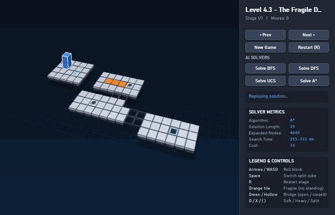
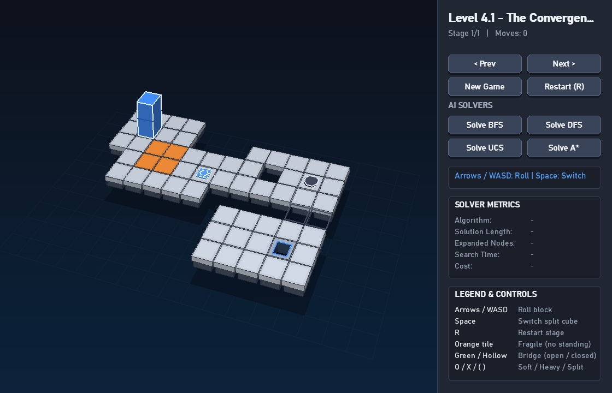
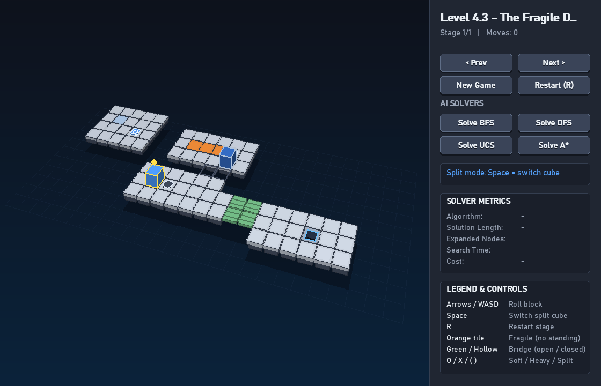
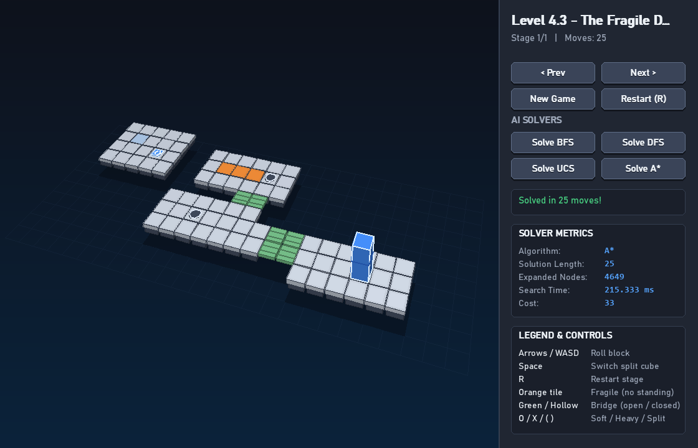
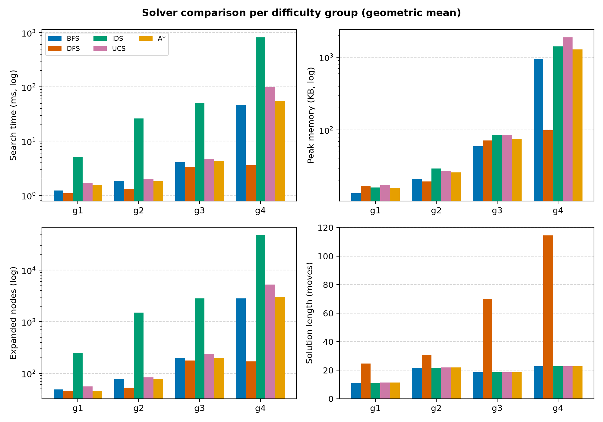
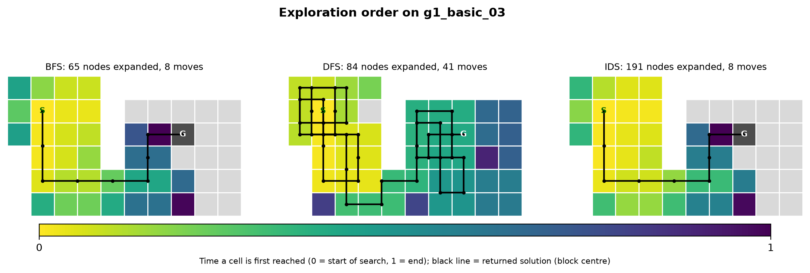

# Bloxorz Solver

A Python reimplementation of the puzzle game **Bloxorz**, with a 3D-style GUI and five search algorithms written from scratch (BFS, DFS, IDS, UCS and A\*) that solve every stage, including fragile tiles, bridges and all three switch types.

<p align="center">
  
</p>

<p align="center"><em>A* solves a stage that needs the split switch: the block splits into two cubes, they move separately, merge again and finish standing in the goal.</em></p>

Built as Project 1 of **CSC14003 Introduction to Artificial Intelligence** at the Faculty of Information Technology, University of Science, VNU-HCM (Group 14).

📺 **Demo video:** https://youtu.be/Mz166a4SrWQ

---

## Features

- **Complete game.** Floor, void and goal tiles; a 1×1×2 block with three orientations; fragile tiles; bridges; soft, heavy and split switches with toggle/open/close behaviour; splitting into two cubes and merging back.
- **Five hand-written search algorithms.** BFS, DFS, IDS, UCS and A\* share one problem interface. No search or pathfinding libraries are used, only `collections.deque`, `heapq`, `dict` and `set`.
- **Physics-based cost function.** Standing the block up costs 3 and every other move costs 1, derived from how far each move lifts the block's centre of mass.
- **Admissible and consistent heuristic.** Proven by hand, and checked exhaustively on all 123,355 reachable transitions of the 16 stages with zero violations.
- **Playable GUI.** Keyboard controls, stage selection, and one-click solving with an animated replay of the solution and live search metrics.
- **Reproducible benchmark.** 16 stages in 4 difficulty groups, four metrics per run (search time, peak memory, expanded nodes, solution length), process-isolated runs with a timeout, and a script that turns the CSV into tables and charts.
- **216 automated tests**, covering every cell of the orientation transition table, every tile rule, and solver optimality on hand-checked stages.

## Screenshots

| Stage with special tiles | Split mode | Solved by A\* |
|:---:|:---:|:---:|
|  |  |  |
| Fragile tiles (orange), switches, a closed bridge and the goal hole | The split switch turns the block into two cubes; Space switches the controlled cube | The sidebar shows the algorithm, solution length, expanded nodes, search time and cost |

## Tech stack

| Area | Tools |
|---|---|
| Language | Python 3.10+ |
| GUI | [Pygame](https://www.pygame.org/), with a hand-written 3D projection for the board, block and roll animations |
| Search | Python standard library only: `collections.deque`, `heapq`, `dict`, `set` |
| Measurement | `time.perf_counter`, `tracemalloc`, `multiprocessing` (one process per run, with a timeout) |
| Charts | [Matplotlib](https://matplotlib.org/), colour-blind-safe Okabe–Ito palette |
| Testing | [pytest](https://pytest.org/) |
| Report | LaTeX (pdfLaTeX + `vntex`), Mermaid for the diagrams |

## How it works

**State.** An immutable, hashable tuple `(block, cubes, bridges)`:

- `block` is the anchor cell and orientation (standing, horizontal or vertical) when the block is whole.
- `cubes` holds the two cube positions when it is split, with the controlled cube first.
- `bridges` is a bitmask with one bit per bridge tile.

Two placements with different bridge configurations are different states. Because states are hashable, every algorithm keeps a visited/closed table keyed by state.

**Actions.** Up, Down, Left, Right, plus Switch while split, always generated in that fixed order so runs are reproducible.

**Transitions.** A move rolls the block with an orientation table, checks that the new placement is legal, then applies tile effects. A placement is illegal if any part is off the board, on a void or closed bridge, or if the block stands on a fragile tile. Tile effects include switching bridges, splitting on a split switch, and merging two adjacent cubes.

**Goal.** The whole block, standing upright, on the goal cell.

| Algorithm | Frontier | Optimal for | Notes |
|---|---|---|---|
| BFS | FIFO queue | number of moves | Goal test on generation |
| DFS | Explicit stack | — | Visited set; no recursion, so long solutions are safe |
| IDS | Stack with a growing depth limit | number of moves | Re-expands a state only when it is reached at a smaller depth |
| UCS | Binary heap on *g* | path cost | Lazy deletion instead of decrease-key |
| A\* | Binary heap on *f = g + h* | path cost | Manhattan distance / 2, split-switch shortcuts, never below the final stand-up cost |

## Results

All five algorithms solve all 16 stages. Values below are geometric means over the four hardest stages (group 4: fragile tiles, switches, bridges and splitting combined).

| Algorithm | Moves | Cost | Expanded nodes | Time (ms) | Peak memory (KB) |
|---|---:|---:|---:|---:|---:|
| BFS | 22.8 | 33.6 | 2,836 | 46.8 | 942 |
| DFS | 114.5 | 162.7 | 171 | 3.6 | 99 |
| IDS | 22.8 | 33.6 | 48,008 | 819.4 | 1,399 |
| UCS | 22.8 | 33.6 | 5,290 | 99.7 | 1,867 |
| A\* | 22.8 | 33.6 | 3,041 | 55.9 | 1,273 |

<p align="center">
  
</p>

Key findings:

- **BFS is the best balance among the uninformed algorithms.** It is optimal in moves and expands far fewer nodes than IDS.
- **DFS is fast but its solutions are poor.** They are 1.0–10.5× longer than the shortest one, and depend on the fixed action order.
- **IDS finds the same solutions as BFS at a much higher cost.** It expands 2.9–38.9× more nodes, and as a graph search it no longer saves memory.
- **Fewest moves is not always cheapest.** On 3 of the 16 stages, UCS and A\* take one extra move to avoid a costly stand-up, and end with a lower total cost.
- **A\* matches UCS's optimal cost while expanding fewer nodes.** It expands 21.7% fewer nodes with the physics cost and 28.8% fewer with unit cost, and up to about 80% fewer on a single stage.

<p align="center">
  
</p>

<p align="center"><em>When each cell is first reached by BFS, DFS and IDS on the same stage (yellow = early, purple = late), with the returned solution drawn in black.</em></p>

Benchmark machine: Intel Core i3-1115G4, 8 GB RAM, Linux, Python 3.14. The raw data and all charts are in [`docs/experiments/`](docs/experiments/).

## Getting started

```bash
git clone https://github.com/cpgod36/bloxorz-solver.git
cd bloxorz-solver/Source
python -m venv .venv
.venv\Scripts\activate            # Windows
# source .venv/bin/activate       # Linux / macOS
pip install -r requirements.txt
python main.py
```

### Controls

| Key / button | Action |
|---|---|
| Arrow keys or W A S D | Roll the block |
| Space | Switch the controlled cube (split mode) |
| R / `Restart` | Restart the stage |
| `< Prev` / `Next >` | Previous / next stage |
| `New Game` | Back to the first stage |
| `Solve BFS` / `DFS` / `UCS` / `A*` | Solve the current stage and replay the solution |
| Esc | Quit |

### Benchmark and tests

Run these from `Source/`:

```bash
python -m benchmark.benchmark --output benchmark/results/run.csv   # all solvers on all 16 stages
python -m benchmark.report benchmark/results/run.csv               # tables and comparison charts
python -m benchmark.illustrations                                  # exploration-order and layer charts
python -m pytest tests
```

## Stage format

Stages are JSON files in `Source/levels/`: a character grid plus a list of switches.

```json
{
  "name": "Example",
  "grid": ["S#O-=#", "##X--#", "#T#FFG"],
  "switches": [
    {"pos": [0, 2], "effect": "toggle", "bridges": [[0, 3], [0, 4]]},
    {"pos": [1, 2], "effect": "open",   "bridges": [[1, 3], [1, 4]]},
    {"pos": [2, 1], "targets": [[0, 0], [2, 0]]}
  ]
}
```

`.` void · `#` floor · `S` start · `G` goal · `F` fragile · `-` / `=` bridge closed / open · `O` soft switch · `X` heavy switch · `T` split switch

## Project structure

```
Source/
├── main.py              GUI entry point
├── bloxorz/
│   ├── core/            State, orientation table, tile rules, stage loader, problem interface
│   ├── solvers/         BFS, DFS, IDS, UCS, A*, cost functions, heuristic, metrics
│   └── gui/             Pygame interface
├── benchmark/           Benchmark runner, tables and charts
├── levels/              16 stages in 4 difficulty groups
└── tests/               pytest suite
docs/
├── experiments/         Benchmark CSV, tables and charts
├── images/              Screenshots used in this README
└── report/latex/        Project report (Vietnamese, LaTeX source)
```

Contributor workflow notes (in Vietnamese) are in [`SETUP.md`](SETUP.md) and [`AGENTS.md`](AGENTS.md).

## Team

| Member | Main contribution |
|---|---|
| Phan Chí Cao (lead) | State representation, orientation table, problem interface, stage format, integration, report |
| Trần Văn Đức | Pygame GUI, threaded solving and replay animation, demo video |
| Võ Phùng Nhật Long | Special tile rules: fragile tiles, bridges, switches, splitting and merging |
| Lâm Duy Minh | UCS, A\*, cost function, heuristic and its proofs, stage design |
| Hoàng Trọng Nghĩa | BFS, DFS, IDS, metrics, benchmark and charts |

## References

- S. Russell, P. Norvig. *Artificial Intelligence: A Modern Approach*, 4th ed. Pearson, 2020.
- P. E. Hart, N. J. Nilsson, B. Raphael. "A Formal Basis for the Heuristic Determination of Minimum Cost Paths". *IEEE Transactions on Systems Science and Cybernetics*, 1968.
- R. E. Korf. "Depth-First Iterative-Deepening: An Optimal Admissible Tree Search". *Artificial Intelligence*, 1985.

Bloxorz was originally created by Damien Clarke. This repository is an independent educational reimplementation made for a university course.
