# Các giải thuật tìm kiếm không có thông tin (BFS, DFS, IDS) và thực nghiệm trên bài toán Bloxorz

## Mục lục

1. Tổng quan hệ thống và quy trình xử lý
2. Hình thức hóa bài toán tìm kiếm
3. Khung tìm kiếm trên đồ thị dùng chung
4. Tìm kiếm theo chiều rộng (BFS)
5. Tìm kiếm theo chiều sâu (DFS)
6. Tìm kiếm lặp sâu dần (IDS)
7. So sánh lý thuyết ba giải thuật
8. Phương pháp đo hiệu năng
9. Thực nghiệm và đánh giá
10. Kết luận

---

## 1. Tổng quan hệ thống và quy trình xử lý

Bài toán yêu cầu tìm dãy nước đi đưa khối hộp 1×1×2 đứng vào ô đích. Phần này trình bày ba giải thuật tìm kiếm không có thông tin: **BFS**, **DFS** và **IDS**. Cả ba đều được nhóm tự cài đặt, chỉ sử dụng các cấu trúc dữ liệu chuẩn của Python (`collections.deque`, `list`, `dict`, `set`) mà không dùng thư viện tìm đường nào. Đề bài cho phép dùng IDS thay cho DFS; nhóm cài đặt **cả hai** và đưa cả hai vào thực nghiệm để có thể so sánh.

Các giải thuật không phụ thuộc vào giao diện đồ họa: lớp lõi (`bloxorz.core`) và lớp giải thuật (`bloxorz.solvers`) không nhập `pygame`, nhờ đó có thể chạy và đo đạc hoàn toàn ở chế độ không giao diện. Sơ đồ 1 mô tả toàn bộ luồng xử lý từ tệp màn chơi đến bảng số liệu trong báo cáo.

**Sơ đồ 1. Quy trình xử lý tổng thể của hệ thống**

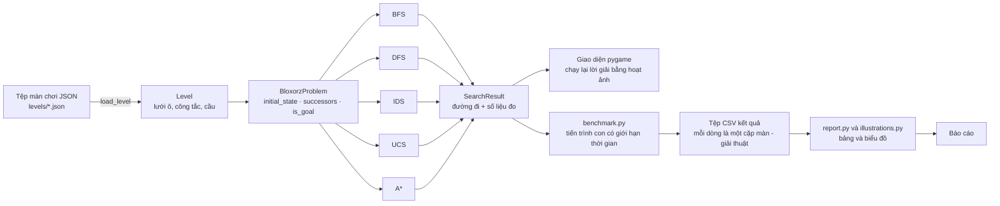

Mọi giải thuật dùng chung một chữ ký gọi hàm và cùng trả về `SearchResult` gồm đường đi (danh sách hành động, hoặc `None` nếu không có lời giải) và bộ bốn số liệu: thời gian tìm kiếm, bộ nhớ đỉnh, số nút mở rộng và độ dài lời giải.

---

## 2. Hình thức hóa bài toán tìm kiếm

### 2.1 Màn chơi

Một màn chơi là một lưới các ô vuông. Mỗi ô thuộc một trong các loại: ô trống (void), sàn thường, ô đích, ô dễ vỡ (fragile), cầu (bridge) và ba loại công tắc (mềm, nặng, tách khối). Hình 1 minh họa một màn đại diện cho từng nhóm độ khó trong bộ kiểm thử.

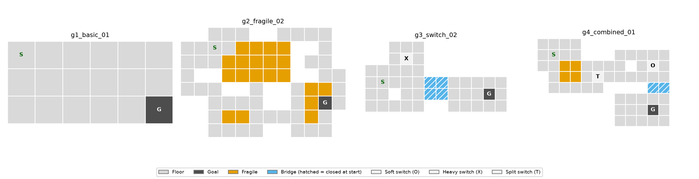

*Hình 1. Bốn màn đại diện cho bốn nhóm độ khó (g1: cơ bản; g2: ô dễ vỡ; g3: công tắc và cầu; g4: kết hợp). Ký hiệu S là ô xuất phát, G là ô đích. Các ô cầu gạch chéo ở trạng thái đóng khi bắt đầu.*

### 2.2 Biểu diễn trạng thái

Trạng thái là một `NamedTuple` **bất biến và băm được (hashable)** gồm ba thành phần:

| Thành phần | Ý nghĩa |
|---|---|
| `block` | Khi khối còn nguyên: ô neo (hàng, cột) và tư thế (`STANDING`, `HORIZONTAL`, `VERTICAL`). Bằng `None` khi khối đã tách. |
| `cubes` | Khi đã tách: vị trí hai khối lập phương 1×1×1; phần tử đầu là khối đang được điều khiển. Bằng `None` khi khối còn nguyên. |
| `bridges` | Số nguyên dùng như mặt nạ bit: bit thứ i bằng 1 nghĩa là cầu thứ i đang mở. |

Ô neo là ô phía trên bên trái của phần khối đang chiếm: tư thế đứng chiếm ô (r, c); nằm ngang chiếm (r, c) và (r, c+1); nằm dọc chiếm (r, c) và (r+1, c).

Hai điểm quan trọng đối với giải thuật tìm kiếm:

1. **Trạng thái bao gồm cả cấu hình cầu.** Hai trạng thái có cùng vị trí khối nhưng khác trạng thái đóng/mở của cầu là hai trạng thái khác nhau. Nhờ vậy việc kiểm tra lặp không bao giờ nhầm lẫn hai tình huống có khả năng đi tiếp khác nhau.
2. **Trạng thái băm được**, nên có thể dùng trực tiếp làm khóa của `dict` và phần tử của `set`, giúp kiểm tra "đã thăm" trong thời gian O(1).

Không gian trạng thái là hữu hạn: với lưới R×C và m cầu, số trạng thái nhiều nhất là 3·R·C·2^m (khối còn nguyên) cộng (R·C)²·2^m (khối đã tách). Tính hữu hạn này là cơ sở để chứng minh các giải thuật dưới đây luôn dừng.

### 2.3 Hành động và mô hình chuyển trạng thái

Tập hành động là **Lên (U), Xuống (D), Trái (L), Phải (R)**, cộng thêm **đổi khối (S)** khi khối đang ở chế độ tách. Các hành động luôn được liệt kê theo **một thứ tự cố định U, D, L, R, (S)** để kết quả của mọi lần chạy có thể tái lập.

Với khối còn nguyên, tư thế mới và vị trí neo mới được tra từ bảng chuyển tư thế (Sơ đồ 2).

**Sơ đồ 2. Chuyển tư thế của khối khi lăn**

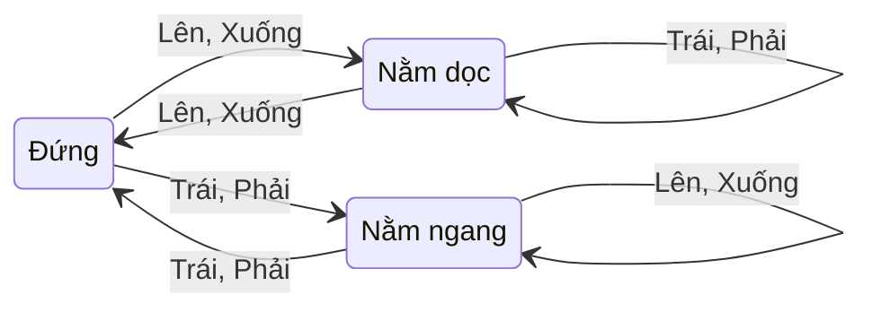

Cụ thể: khối đứng lăn ngã thành nằm theo hướng lăn; khối nằm dọc theo hướng lăn thì dựng lên đứng; khối nằm ngang qua hướng lăn thì lăn sang bên và vẫn nằm. Nước đi hợp lệ phải thỏa mãn mọi điều kiện sau:

- mọi ô khối đang chiếm đều nằm trong lưới, không phải ô trống và không phải cầu đang đóng;
- khối **đang đứng** thì không được đứng trên ô dễ vỡ;
- ở chế độ tách, hai khối lập phương không được trùng ô.

Sau một nước đi hợp lệ, các công tắc bị kích hoạt sẽ tác động lên trạng thái (đóng, mở hoặc đảo cầu; tách khối; ghép hai khối khi chúng kề nhau). Sơ đồ 3 tóm tắt cách sinh các trạng thái kế tiếp.

**Sơ đồ 3. Sinh các trạng thái kế tiếp `successors(s)`**

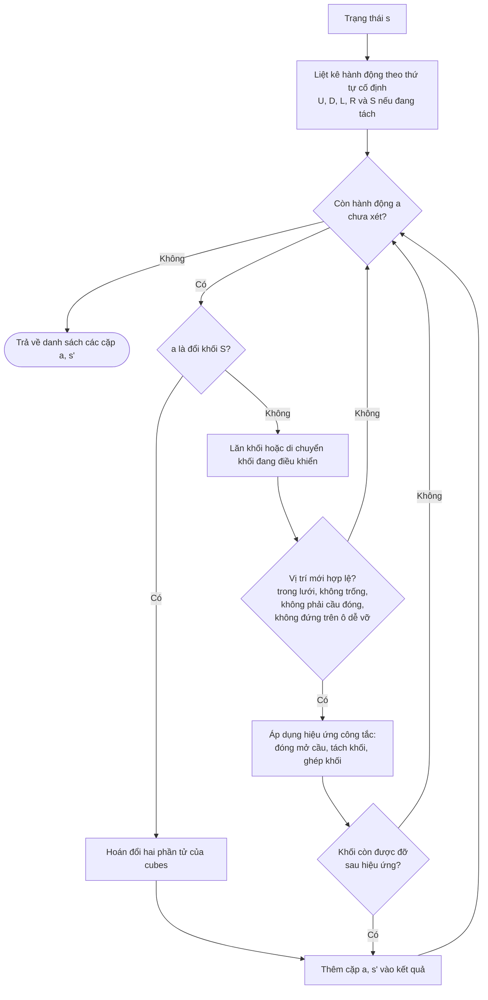

### 2.4 Kiểm tra đích và chi phí

- **Kiểm tra đích** `is_goal(s)`: cả khối ở tư thế đứng và đứng trên ô đích. Khối lập phương đơn lẻ không bao giờ thắng.
- **Chi phí**: BFS, DFS và IDS đều coi **mỗi nước đi có chi phí 1**, nên các giải thuật này đánh giá lời giải theo *số nước đi*. Riêng UCS và A\* dùng một hàm chi phí không đồng nhất `physics_cost` (xem phần mô tả UCS và A\*). Để so sánh công bằng, quá trình thực nghiệm còn tính cho **mọi** lời giải, kể cả của BFS, DFS, IDS, tổng chi phí theo `physics_cost`. Cột "Cost" trong các bảng ở mục 9 có ý nghĩa này.

### 2.5 Đồ thị trạng thái và sự cần thiết của việc chống lặp

Do khối có thể lăn qua lại, từ trạng thái s có thể quay về chính s sau vài nước đi (chẳng hạn lăn sang phải rồi lăn lại sang trái). Đồ thị trạng thái vì vậy có **chu trình**, và nhiều đường đi khác nhau cùng dẫn tới một trạng thái. Nếu duyệt như duyệt cây, giải thuật có thể lặp vô hạn (DFS) hoặc lãng phí thời gian vào các nhánh trùng lặp (BFS). Cả ba giải thuật vì vậy đều là **tìm kiếm trên đồ thị (graph search)**: dùng bảng tra theo trạng thái băm được để không xử lý lại những trạng thái đã gặp.

---

## 3. Khung tìm kiếm trên đồ thị dùng chung

Ba giải thuật cùng một khung; chúng chỉ khác nhau ở **cấu trúc dữ liệu của frontier** (tập các nút đã sinh nhưng chưa mở rộng) và **cách chọn nút để mở rộng tiếp theo**:

```
GRAPH-SEARCH(problem):
    frontier ← { s0 }                  # s0 = problem.initial_state
    reached  ← { s0 }                  # các trạng thái đã gặp, kèm con trỏ cha
    while frontier ≠ ∅:
        s ← CHỌN-VÀ-LẤY-RA(frontier)   # điểm khác nhau giữa các giải thuật
        nếu s là đích: dựng lại đường đi bằng cách lần ngược theo con trỏ cha
        mở rộng s: với mỗi (a, s') ∈ successors(s):
            nếu s' chưa có trong reached:
                ghi nhận s' (cha = s, hành động = a), đưa s' vào frontier
    return thất bại
```

Khung trên kiểm tra đích lúc lấy nút ra, nên nút đích không bao giờ bị mở rộng. DFS và IDS dùng đúng cách này; BFS kiểm tra sớm hơn, ngay khi nút được sinh ra (mục 4.4).

| Giải thuật | Frontier | Chọn nút | Ý nghĩa |
|---|---|---|---|
| BFS | Hàng đợi FIFO (`deque`) | Nút vào sớm nhất | Duyệt theo từng lớp độ sâu |
| DFS | Ngăn xếp LIFO (`list`) | Nút vào muộn nhất | Đi sâu trước, quay lui sau |
| IDS | Ngăn xếp, có giới hạn độ sâu tăng dần | Như DFS trong mỗi lượt | Lặp lại DFS với giới hạn 1, 2, 3, … |

**Ghi nhận đường đi.** Thay vì lưu kèm danh sách hành động trong mỗi phần tử của frontier (tốn thêm bộ nhớ tỉ lệ với độ sâu cho mỗi nút), mỗi trạng thái chỉ lưu `(trạng thái cha, hành động đã dùng)` trong từ điển `parent`. Khi tìm thấy đích, đường đi được dựng bằng cách lần ngược từ đích về trạng thái đầu rồi đảo thứ tự.

**Quy ước đếm số nút mở rộng (expanded nodes).** Một nút được tính là *đã mở rộng* khi nó được lấy ra khỏi frontier **và** các nút con của nó được sinh ra (gọi `successors`). Nút đích không được tính vì không cần sinh nút con của nó. Quy ước này được áp dụng thống nhất cho mọi giải thuật thông qua `MetricsTracker.count_expansion()`, nhờ vậy các con số có thể so sánh với nhau. Với IDS, số này là tổng cộng dồn qua tất cả các lượt lặp.

---

## 4. Tìm kiếm theo chiều rộng (BFS)

### 4.1 Ý tưởng

BFS mở rộng toàn bộ các trạng thái cách trạng thái đầu 0 nước đi, rồi đến 1 nước, 2 nước, … Mọi trạng thái ở độ sâu k đều được mở rộng trước mọi trạng thái ở độ sâu k+1. Frontier là hàng đợi FIFO, cài đặt bằng `collections.deque` để cả `append` (thêm vào cuối) lẫn `popleft` (lấy từ đầu) đều có chi phí O(1).

### 4.2 Lưu đồ

**Sơ đồ 4. Lưu đồ BFS**

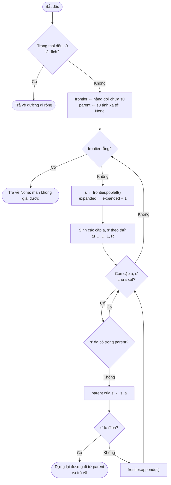

### 4.3 Mã giả

```
BFS(problem):
    s0 ← problem.initial_state
    nếu is_goal(s0): trả về []                       # 0 nước đi, 0 nút mở rộng
    frontier ← deque([s0])
    parent   ← { s0: None }                           # đồng thời là tập các trạng thái đã thăm
    trong khi frontier không rỗng:
        s ← frontier.popleft()
        expanded ← expanded + 1
        với mỗi (a, s') trong successors(s):          # thứ tự U, D, L, R (S nếu đang tách)
            nếu s' ∉ parent:
                parent[s'] ← (s, a)
                nếu is_goal(s'): trả về reconstruct(parent, s')   # kiểm tra đích sớm
                frontier.append(s')
    trả về None
```

### 4.4 Các quyết định cài đặt

- **Kiểm tra đích sớm.** Đích được kiểm tra ngay khi trạng thái được *sinh ra*, không đợi đến khi nó được lấy khỏi hàng đợi. Điều này đúng vì mọi nước đi có cùng chi phí nên trạng thái đích được sinh ra đầu tiên chắc chắn nằm ở độ sâu nhỏ nhất. Cách làm này tránh việc phải mở rộng thêm cả một lớp độ sâu trước khi trả về (Russell và Norvig, AIMA). Hệ quả là nút đích ở độ sâu d được phát hiện khi mở rộng một nút ở độ sâu d−1, và Hình 3 cho thấy lớp cuối cùng được mở rộng chỉ có độ sâu d−1.
- **Từ điển `parent` đóng hai vai trò**: lưu con trỏ cha để dựng đường đi và là tập đã thăm để chống lặp. Một trạng thái chỉ vào frontier khi chưa từng xuất hiện trong `parent`, do đó mỗi trạng thái được mở rộng tối đa một lần.
- **Frontier chỉ chứa trạng thái**, không chứa đường đi, như đã nêu ở mục 3.

### 4.5 Ví dụ chạy tay trên màn g1_basic_01

Màn gồm lưới 3 hàng × 6 cột toàn sàn thường, xuất phát tại (0,0), đích tại (2,5). Kí hiệu trạng thái: chữ cái là tư thế (S: đứng, H: nằm ngang, V: nằm dọc) kèm ô neo (hàng, cột).

| Bước | Nút được lấy ra | Các nút con sinh ra (hành động: trạng thái) | Ghi chú |
|---:|---|---|---|
| 1 | S(0,0) | D: V(1,0); R: H(0,1) | U và L ra ngoài lưới nên bị loại |
| 2 | V(1,0) | U: S(0,0); R: V(1,1) | S(0,0) đã có trong `parent` nên bị bỏ qua |
| 3 | H(0,1) | D: H(1,1); L: S(0,0); R: S(0,3) | S(0,0) bị bỏ qua |
| 4 | V(1,1) | U: S(0,1); L: V(1,0); R: V(1,2) | V(1,0) bị bỏ qua |

Số nút được mở rộng theo từng độ sâu là `[1, 2, 3, 7, 6, 8, 9, 5]` (tổng 41 nút). Nút đích được sinh ra ở độ sâu 8 khi đang mở rộng một nút ở độ sâu 7, và đường đi trả về là **DRRURDDR** (8 nước đi).

### 4.6 Tính chất và chứng minh

**Tính dừng và tính đầy đủ.** Không gian trạng thái hữu hạn (mục 2.2) và mỗi trạng thái vào frontier tối đa một lần, nên vòng lặp luôn kết thúc. Nếu đích đạt tới được thì nó sẽ được sinh ra ở một lúc nào đó, vì mọi trạng thái đạt tới được đều lần lượt được mở rộng. Nếu frontier cạn mà chưa gặp đích, màn không có lời giải. Do đó BFS đầy đủ và quyết định được tính giải được của màn.

**Tính tối ưu theo số nước đi.** Chứng minh bằng quy nạp theo độ sâu k: *mọi trạng thái ở độ sâu k (khoảng cách ngắn nhất tính bằng số nước đi từ trạng thái đầu) được đưa vào hàng đợi trước mọi trạng thái ở độ sâu k+1, và `parent` của nó lưu đúng một đường đi có độ dài k.*

- Cơ sở: độ sâu 0 chỉ có s0.
- Bước quy nạp: mọi trạng thái ở độ sâu k+1 có một nút cha ở độ sâu k. Theo giả thiết, các nút ở độ sâu k đều được lấy ra (và mở rộng) trước các nút ở độ sâu k+1, nên trạng thái ở độ sâu k+1 được sinh ra đầu tiên từ một nút độ sâu k. Không nút nào ở độ sâu lớn hơn có thể sinh ra nó sớm hơn vì chúng được lấy ra sau.

Do đó lần đầu một trạng thái được phát hiện chính là lúc nó được phát hiện bằng đường ngắn nhất, và đích được phát hiện lần đầu cho lời giải có số nước đi nhỏ nhất. Tính chất này chỉ đảm bảo tối ưu theo **số nước đi**; không đảm bảo tối ưu theo `physics_cost` (mục 9.4).

**Độ phức tạp.** Mỗi trạng thái được mở rộng tối đa một lần, mỗi lần sinh tối đa b nút con (b ≤ 4, hoặc 5 khi đang tách) và mỗi thao tác tra bảng băm là O(1). Thời gian là O(b·|S|) = O(|S|), và theo độ sâu lời giải d còn bị chặn bởi O(b^d). Bộ nhớ là O(|S|) vì phải giữ cả frontier lẫn `parent`. Thực tế số nút theo từng độ sâu tăng chậm hơn nhiều so với b^d vì đồ thị trạng thái có nhiều đường song song và chu trình (Hình 3).

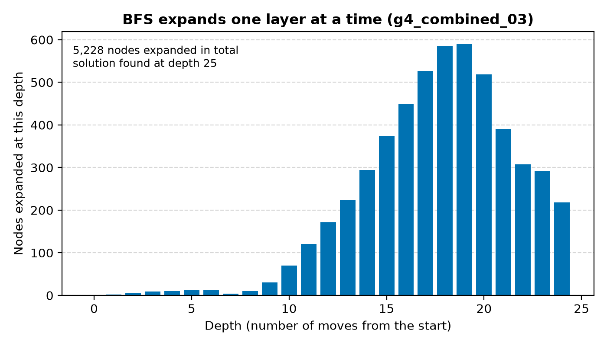

*Hình 3. Số nút BFS mở rộng ở từng độ sâu trên màn g4_combined_03: tổng 5.228 nút, lời giải ở độ sâu 25. Số nút theo lớp tăng đến cực đại ở độ sâu 18–19 rồi giảm.*

---

## 5. Tìm kiếm theo chiều sâu (DFS)

### 5.1 Ý tưởng

DFS luôn đi sâu theo một nhánh cho đến khi gặp ngõ cụt (mọi nước đi đều dẫn đến trạng thái đã thăm hoặc không hợp lệ), rồi quay lui để thử nhánh khác. Frontier là ngăn xếp LIFO. Giải thuật được cài đặt **bằng ngăn xếp tường minh** (một `list` với `append` và `pop`) mà không dùng đệ quy, để không gặp `RecursionError` khi lời giải dài (DFS tìm được lời giải 304 nước ở màn g4_combined_02).

### 5.2 Lưu đồ

**Sơ đồ 5. Lưu đồ DFS**

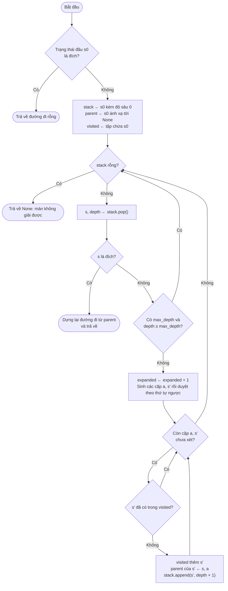

### 5.3 Mã giả

```
DFS(problem, max_depth = None):
    s0 ← problem.initial_state
    nếu is_goal(s0): trả về []
    stack   ← [(s0, 0)]
    parent  ← { s0: None };  visited ← { s0 }
    trong khi stack không rỗng:
        (s, depth) ← stack.pop()
        nếu is_goal(s): trả về reconstruct(parent, s)
        nếu max_depth ≠ None và depth ≥ max_depth: tiếp tục vòng lặp       # cắt nhánh
        expanded ← expanded + 1
        với mỗi (a, s') trong reversed(successors(s)):
            nếu s' ∉ visited:
                visited.add(s');  parent[s'] ← (s, a)
                stack.append((s', depth + 1))
    trả về None
```

### 5.4 Các quyết định cài đặt

- **Duyệt `reversed(successors(s))`.** Ngăn xếp lấy phần tử *đưa vào sau cùng* ra trước. Đưa các nút con vào theo thứ tự ngược lại thì nút con *đầu tiên* theo thứ tự quy ước (Lên) nằm ở đỉnh và được duyệt trước, nhờ đó thứ tự duyệt vẫn là U, D, L, R. Nếu bỏ `reversed`, DFS sẽ duyệt Phải trước và cho một lời giải khác.
- **Đánh dấu đã thăm lúc đưa vào ngăn xếp** (không phải lúc lấy ra). Mỗi trạng thái vào ngăn xếp tối đa một lần nên ngăn xếp không chứa bản sao.
- **Kiểm tra đích lúc lấy ra khỏi ngăn xếp.** Khác với BFS, đích đầu tiên mà DFS gặp không nhất thiết ở độ sâu nhỏ nhất, nên kiểm tra sớm không mang lại lợi ích về tính tối ưu. Nút đích được kiểm tra trước khi tính vào `expanded`, do đó không bị đếm, nhất quán với BFS.
- **Tham số `max_depth`** là giới hạn độ sâu tùy chọn; cơ chế cắt nhánh này là nền tảng của IDS.

### 5.5 Ví dụ chạy tay trên màn g1_basic_01

Ngăn xếp được viết với đỉnh ở bên phải.

| Bước | Nút lấy ra (đỉnh) | Nút con hợp lệ | Ngăn xếp sau bước |
|---:|---|---|---|
| 1 | S(0,0) | D: V(1,0); R: H(0,1) | H(0,1), V(1,0) |
| 2 | V(1,0) | U: S(0,0) đã thăm, bỏ; R: V(1,1) | H(0,1), V(1,1) |
| 3 | V(1,1) | U: S(0,1); L: V(1,0) đã thăm, bỏ; R: V(1,2) | H(0,1), V(1,2), S(0,1) |
| 4 | S(0,1) | D: V(1,1) đã thăm, bỏ; R: H(0,2) | H(0,1), V(1,2), H(0,2) |

Ở bước 1, nút con thứ nhất (D) được đưa vào sau cùng nên nằm ở đỉnh, và DFS đi sâu theo nhánh này trong khi H(0,1) nằm lại phía dưới chờ quay lui. DFS trả về lời giải **DRURDDLULDRURRULDRRULDDR** gồm 24 nước đi sau 29 lần mở rộng, tức dài gấp ba lần lời giải tối ưu 8 nước của BFS.

### 5.6 Tính chất và chứng minh

**Tính đầy đủ.** Nhờ tập `visited` và không gian trạng thái hữu hạn, mỗi trạng thái vào ngăn xếp tối đa một lần nên vòng lặp luôn dừng. Ngăn xếp chỉ cạn khi mọi trạng thái đạt tới được đã được lấy ra; vì vậy nếu đích đạt tới được, nó chắc chắn sẽ được lấy ra và trả về. DFS có `visited` là đầy đủ, khác với DFS dạng cây có thể lặp vô hạn trên đồ thị có chu trình.

**Không tối ưu.** DFS trả về lời giải đầu tiên nó gặp, phụ thuộc vào thứ tự duyệt cố định chứ không vào độ dài. Ví dụ trên màn g1_basic_03, BFS tìm được lời giải 8 nước còn DFS trả về 41 nước (Hình 2). Hơn nữa việc đánh dấu `visited` lúc đưa vào ngăn xếp khiến một trạng thái giữ lại đường đi tới nó theo lần phát hiện đầu tiên, dù đường này có thể rất dài.

**Độ phức tạp.** Thời gian O(|S|) trong trường hợp xấu nhất (mỗi trạng thái mở rộng tối đa một lần); trên thực tế số nút mở rộng phụ thuộc vào việc nhánh đầu tiên có sớm dẫn tới đích không. Về bộ nhớ, DFS dạng cây chỉ cần O(b·d) nhưng DFS trên đồ thị phải giữ `visited` và `parent` cho mọi trạng thái **đã sinh ra**, nên bộ nhớ tăng theo số trạng thái đã khám phá chứ không còn tuyến tính theo độ sâu.

---

## 6. Tìm kiếm lặp sâu dần (IDS)

### 6.1 Ý tưởng

IDS kết hợp ưu điểm của hai giải thuật trên: tối ưu theo số nước đi như BFS, nhưng mỗi lượt duyệt theo kiểu DFS. Giải thuật chạy lặp lại **tìm kiếm có giới hạn độ sâu (Depth-Limited Search, DLS)** với giới hạn 0, 1, 2, … cho đến khi tìm thấy đích. Lượt lặp đầu tiên có giới hạn đủ lớn để chạm tới đích sẽ cho lời giải ngắn nhất theo số nước.

### 6.2 Lưu đồ

**Sơ đồ 6. Lưu đồ IDS**

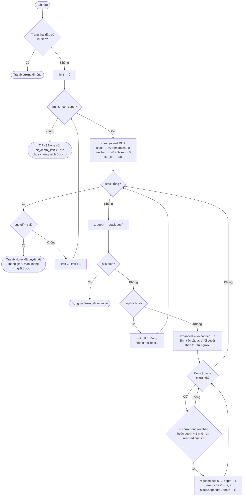

### 6.3 Mã giả

```
IDS(problem, max_depth = 100):
    s0 ← problem.initial_state
    nếu is_goal(s0): trả về []
    với limit = 0, 1, 2, ..., max_depth:
        stack ← [(s0, 0)];  parent ← { s0: None };  reached ← { s0: 0 };  cut_off ← sai
        trong khi stack không rỗng:
            (s, depth) ← stack.pop()
            nếu is_goal(s): trả về reconstruct(parent, s)
            nếu depth ≥ limit:
                cut_off ← đúng                        # có thể còn nút sâu hơn bị cắt
            ngược lại:
                expanded ← expanded + 1
                với mỗi (a, s') trong reversed(successors(s)):
                    nếu s' ∉ reached hoặc depth + 1 < reached[s']:
                        reached[s'] ← depth + 1;  parent[s'] ← (s, a)
                        stack.append((s', depth + 1))
        nếu không cut_off: trả về None                 # không nút nào bị giới hạn cắt: đã duyệt hết
    trả về None với hit_depth_limit = đúng              # hết max_depth, chưa kết luận được
```

### 6.4 Các quyết định cài đặt

- **Chống lặp theo độ sâu nhỏ nhất (`reached`).** Trong một lượt, mỗi trạng thái nhớ độ sâu nhỏ nhất đã đạt tới. Nếu gặp lại ở độ sâu lớn hơn hoặc bằng thì bỏ qua; nếu gặp lại ở độ sâu *nhỏ hơn* thì cho phép đưa vào ngăn xếp lần nữa. Không thể dùng tập `visited` đơn giản như DFS: một trạng thái có thể đến lần đầu bằng đường dài (đã sát giới hạn) nên bị cắt, trong khi một đường ngắn hơn đến nó sau đó vẫn cần được đi tiếp. Dùng `visited` đơn giản sẽ làm IDS mất tính tối ưu.
- **Phân biệt "không giải được" và "hết giới hạn".** Nếu một lượt kết thúc mà không có nút nào bị cắt bởi giới hạn (`cut_off = sai`), toàn bộ không gian đạt tới được đã được duyệt và có thể kết luận màn không giải được. Nếu hết `max_depth` mà vẫn còn nút bị cắt thì chỉ có thể trả `hit_depth_limit = True`, nghĩa là chưa kết luận được. Chương trình benchmark ghi hai tình huống này thành trạng thái khác nhau (`UNSOLVABLE` và `LIMIT`).
- **Nút nằm đúng ở giới hạn không được tính là mở rộng**, chỉ đánh dấu `cut_off`.
- **Mỗi lượt khởi tạo lại `parent` và `reached`**, vì độ sâu ghi nhận chỉ có nghĩa trong phạm vi một giới hạn.

### 6.5 Ví dụ trên màn g1_basic_01

Số nút mở rộng ở từng lượt với giới hạn 1, 2, …, 8 là `[1, 3, 6, 13, 20, 31, 44, 24]`, tổng **142 nút**, so với 41 nút của BFS. Lượt giới hạn 1 chỉ mở rộng s0; lượt giới hạn 2 mở rộng s0 cùng hai con của nó (3 nút); mỗi lượt sau lại phải đi qua toàn bộ phần đã duyệt ở lượt trước. Lượt giới hạn 8 dừng sớm (24 nút) vì gặp đích. Lời giải trả về là **DRRURDDR**, trùng với BFS.

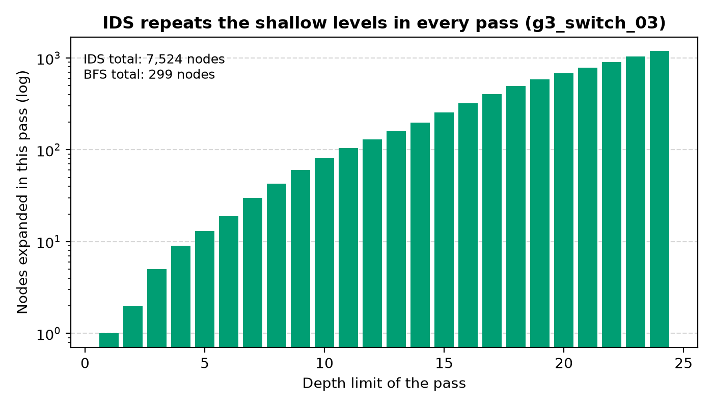

*Hình 4. Số nút mở rộng ở từng lượt lặp của IDS trên màn g3_switch_03 (thang log): tổng 7.524 nút so với 299 nút của BFS. Chỉ riêng lượt cuối (giới hạn 24) đã mở rộng 1.189 nút, nhiều hơn toàn bộ BFS.*

### 6.6 Tính chất và chứng minh

**Tính đầy đủ.** Nếu đích ở độ sâu d* (số nước đi ngắn nhất), đến lượt giới hạn d* giải thuật sẽ tìm thấy nó (chứng minh bên dưới). Nếu đích không đạt tới được, mọi lượt đều không có đích; khi giới hạn đủ lớn để không còn nút nào bị cắt, giải thuật kết luận không giải được.

**Tính tối ưu theo số nước đi.** Khẳng định: sau lượt giới hạn L, mọi trạng thái có khoảng cách ngắn nhất k ≤ L đều đã được đưa vào ngăn xếp ít nhất một lần với độ sâu đúng bằng k. Chứng minh bằng quy nạp theo k: s0 có độ sâu 0. Nếu s có khoảng cách k+1 ≤ L thì tồn tại nút cha p có khoảng cách k, được đưa vào với độ sâu k theo giả thiết và được lấy ra mở rộng với độ sâu k < L (vì k < L). Khi đó s được sinh ra với độ sâu k+1. Nó được đưa vào ngăn xếp trừ khi đã có `reached[s]` ≤ k+1; mà `reached[s]` không thể nhỏ hơn khoảng cách thực k+1, nên trong cả hai trường hợp s đã được đưa vào với độ sâu k+1. Hệ quả: lượt đầu tiên tìm thấy đích là lượt L = d*, và đường đi trả về dài d* nước. Nhờ điều kiện "độ sâu nhỏ hơn thì cho vào lại", phép chứng minh này không bị phá bởi thứ tự duyệt kiểu DFS.

**Độ phức tạp.** Các trạng thái ở độ sâu nhỏ bị mở rộng lại ở mọi lượt, nên tổng số nút mở rộng lớn hơn BFS. Với cây có hệ số nhánh b đều, hệ số chi phí xấp xỉ b/(b−1); với đồ thị trạng thái của Bloxorz, hệ số nhánh hiệu dụng nhỏ (số nút mỗi lượt chỉ tăng khoảng 1,1 đến 1,5 lần khi giới hạn tăng thêm 1, Hình 4) nên chi phí lặp lại lớn. Thêm vào đó, một lượt với giới hạn L còn mở rộng nhiều hơn số trạng thái cách s0 tối đa L nước, do một trạng thái có thể bị mở rộng lại mỗi khi được phát hiện ở độ sâu nhỏ hơn trong cùng lượt; vì vậy lượt cuối ở Hình 4 (1.189 nút) vượt tổng của BFS (299 nút). Về bộ nhớ, `reached` và `parent` giữ mọi trạng thái của một lượt, nên IDS **không** còn bộ nhớ tuyến tính như IDS dạng cây mà cùng bậc với BFS (đo được gấp 1,2 đến 1,6 lần BFS).

---

## 7. So sánh lý thuyết ba giải thuật

| Tiêu chí | BFS | DFS | IDS |
|---|---|---|---|
| Frontier | Hàng đợi FIFO | Ngăn xếp LIFO | Ngăn xếp LIFO, giới hạn độ sâu tăng dần |
| Thời điểm kiểm tra đích | Khi sinh nút con | Khi lấy ra khỏi ngăn xếp | Khi lấy ra khỏi ngăn xếp |
| Chống lặp | `parent` (một lần cho mỗi trạng thái) | `visited` (một lần cho mỗi trạng thái) | `reached` (độ sâu nhỏ nhất, theo từng lượt) |
| Đầy đủ | Có | Có (nhờ `visited`) | Có |
| Tối ưu theo số nước đi | Có | Không | Có |
| Tối ưu theo `physics_cost` | Không đảm bảo | Không | Không đảm bảo |
| Thời gian | O(\|S\|), chặn bởi O(b^d) | O(\|S\|) | Lớn hơn BFS nhiều lần do mở rộng lại |
| Bộ nhớ | O(\|S\|) | O(số trạng thái đã sinh) | O(\|S\|) cho mỗi lượt |
| Phát hiện màn không giải được | Có (frontier cạn) | Có (ngăn xếp cạn) | Có (lượt không bị cắt); nếu hết `max_depth` thì chưa kết luận |

---

## 8. Phương pháp đo hiệu năng

Bốn chỉ số được ghi nhận cho mỗi lượt chạy, theo yêu cầu của đề bài:

| Chỉ số | Cách đo |
|---|---|
| Thời gian tìm kiếm | `time.perf_counter()` (đồng hồ độ phân giải cao, đơn điệu, không bị ảnh hưởng khi đổi giờ hệ thống) |
| Bộ nhớ đỉnh | `tracemalloc`, trừ đi mức bộ nhớ đã cấp phát lúc bắt đầu tìm kiếm để không tính phần chuẩn bị trước đó |
| Số nút mở rộng | Theo định nghĩa ở mục 3, đếm qua `MetricsTracker.count_expansion()` |
| Độ dài lời giải | Số hành động của đường đi trả về |

Ngoài ra, mỗi lời giải còn được gán một giá trị **cost** bằng tổng `physics_cost` của đường đi, tính chung một thang cho mọi giải thuật để so sánh được cả với UCS và A\*.

Ba biện pháp đảm bảo độ tin cậy của phép đo (Sơ đồ 7):

1. **Mỗi lần đo chạy trong một tiến trình con riêng** với giới hạn thời gian (mặc định 30 giây). Cách này dùng được trên mọi hệ điều hành (không phụ thuộc `SIGALRM`) và tiến trình bị dừng hẳn khi quá hạn.
2. **Thời gian và bộ nhớ được đo ở hai lần chạy riêng.** `tracemalloc` làm chậm chương trình khoảng 3 đến 4 lần nên thời gian được đo khi tắt nó; bộ nhớ đỉnh được đo ở một lần chạy bật nó.
3. **Các lượt chạy nhanh (dưới 1 giây) được lặp lại** (mặc định 3 lần) và lấy **trung vị**, vì màn nhỏ chạy chỉ vài mili giây nên một mẫu đơn lẻ chủ yếu là nhiễu.

**Sơ đồ 7. Quy trình đo một cặp (màn, giải thuật)**

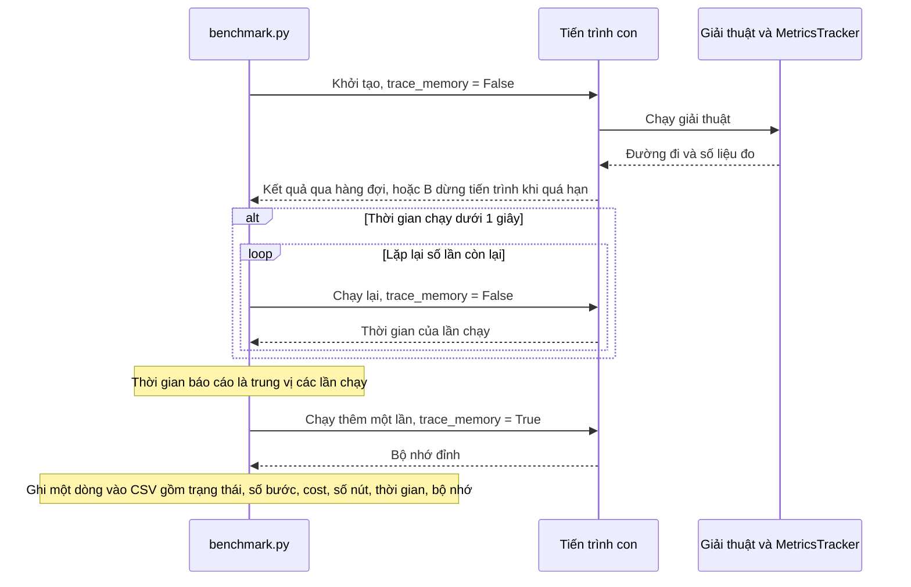

---

## 9. Thực nghiệm và đánh giá

### 9.1 Bộ kiểm thử và môi trường

**Bộ kiểm thử cố định** gồm 16 màn trong thư mục `Source/levels/`, chia thành 4 nhóm theo độ khó tăng dần, mỗi nhóm 4 màn (Hình 1). Mọi giải thuật chạy trên đúng cùng bộ màn này và mọi màn đều giải được (đã kiểm chứng bằng BFS).

| Nhóm | Đặc điểm | Màn |
|---|---|---|
| g1 | Cơ bản: chỉ có ô sàn thường, ô trống và ô đích | `g1_basic_01..04` |
| g2 | Có ô dễ vỡ (khối đứng lên sẽ rơi) | `g2_fragile_01..04` |
| g3 | Có công tắc và cầu (mềm, nặng, tách khối; đảo hoặc cố định trạng thái cầu) | `g3_switch_01..04` |
| g4 | Kết hợp ô dễ vỡ, công tắc, cầu và tách khối | `g4_combined_01..04` |

**Môi trường chạy:** Intel Core i3-1115G4 @ 3,0 GHz (4 luồng), khoảng 8 GB RAM, Linux, Python 3.14.7.

Tổng cộng 16 màn × 5 giải thuật (BFS, DFS, IDS, UCS, A\*) = 80 lượt chạy; **tất cả đều giải được**, không có lượt nào vượt giới hạn thời gian.

### 9.2 Quan sát trực quan cách các giải thuật duyệt không gian

Hình 2 đặt BFS, DFS và IDS cạnh nhau trên cùng một màn nhỏ (g1_basic_03). Màu của mỗi ô cho biết thời điểm ô đó lần đầu bị một trạng thái được mở rộng chiếm giữ (vàng là sớm, tím là muộn); đường đen là lời giải được trả về.

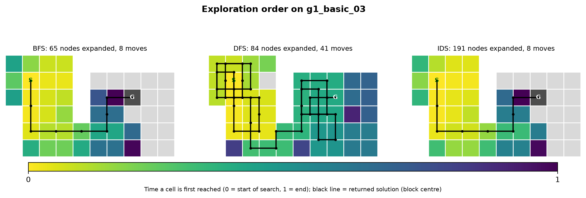

*Hình 2. Thứ tự khám phá bàn chơi và lời giải của BFS (65 nút, 8 nước), DFS (84 nút, 41 nước) và IDS (191 nút, 8 nước) trên màn g1_basic_03.*

Các quan sát từ hình:

- **BFS** lan đều theo mọi hướng từ ô xuất phát như một vết loang, nên màu chuyển dần từ vàng sang tím theo khoảng cách đến ô xuất phát, và đường đi ngắn gọn.
- **DFS** đi sâu vào một vùng rồi quay lui. Phần bên trái của bàn bị đi đi lại lại nhiều lần trước khi sang được phía bên phải, dẫn tới lời giải 41 nước, dài hơn 5 lần lời giải tối ưu. Số nút mở rộng (84) còn lớn hơn BFS (65) trên màn này.
- **IDS** cho cùng lời giải với BFS nhưng phải mở rộng 191 nút, gấp khoảng 3 lần BFS, do các lượt lặp.

### 9.3 Bảng số liệu tổng hợp theo nhóm

Các giá trị là **trung bình nhân** trên 4 màn của mỗi nhóm. Trung bình nhân được chọn vì số nút mở rộng trải qua nhiều bậc độ lớn giữa các màn; trung bình cộng sẽ bị một màn khó nhất (`g4_combined_04`) chi phối. UCS và A\* được đưa vào để đối chiếu.

| Nhóm | Giải thuật | Số bước | Cost | Số nút mở rộng | Thời gian (ms) | Bộ nhớ đỉnh (KB) |
|---|---|---:|---:|---:|---:|---:|
| g1 | BFS | 11,0 | 17,7 | 49 | 1,23 | 13,5 |
| g1 | DFS | 24,7 | 39,2 | 46 | 1,10 | 17,0 |
| g1 | IDS | 11,0 | 17,7 | 252 | 5,02 | 16,2 |
| g1 | UCS | 11,3 | 17,3 | 56 | 1,69 | 17,5 |
| g1 | A\* | 11,3 | 17,3 | 46 | 1,58 | 16,0 |
| g2 | BFS | 21,6 | 33,8 | 78 | 1,85 | 21,4 |
| g2 | DFS | 30,9 | 48,9 | 53 | 1,31 | 19,7 |
| g2 | IDS | 21,6 | 33,8 | 1.501 | 26,15 | 29,6 |
| g2 | UCS | 22,0 | 33,4 | 83 | 1,98 | 27,5 |
| g2 | A\* | 22,0 | 33,4 | 78 | 1,84 | 26,1 |
| g3 | BFS | 18,5 | 33,1 | 199 | 4,09 | 60,1 |
| g3 | DFS | 70,1 | 116,4 | 178 | 3,38 | 71,5 |
| g3 | IDS | 18,5 | 33,1 | 2.833 | 51,19 | 85,5 |
| g3 | UCS | 18,6 | 32,9 | 239 | 4,70 | 86,1 |
| g3 | A\* | 18,6 | 32,9 | 198 | 4,34 | 75,1 |
| g4 | BFS | 22,8 | 33,6 | 2.836 | 46,79 | 942,3 |
| g4 | DFS | 114,5 | 162,7 | 171 | 3,61 | 98,8 |
| g4 | IDS | 22,8 | 33,6 | 48.008 | 819,42 | 1.398,7 |
| g4 | UCS | 22,8 | 33,6 | 5.290 | 99,74 | 1.866,8 |
| g4 | A\* | 22,8 | 33,6 | 3.041 | 55,85 | 1.273,1 |

Bảng chi tiết nhóm khó nhất (g4), nơi các giải thuật phân biệt rõ nhất:

| Màn | Giải thuật | Số bước | Cost | Số nút mở rộng | Thời gian (ms) | Bộ nhớ đỉnh (KB) |
|---|---|---:|---:|---:|---:|---:|
| g4_combined_01 | BFS | 12 | 22 | 242 | 3,88 | 108,0 |
| g4_combined_01 | DFS | 24 | 42 | 42 | 0,96 | 16,6 |
| g4_combined_01 | IDS | 12 | 22 | 1.175 | 19,48 | 135,4 |
| g4_combined_02 | BFS | 29 | 39 | 4.597 | 74,68 | 1.233,2 |
| g4_combined_02 | DFS | 304 | 376 | 390 | 9,11 | 273,8 |
| g4_combined_02 | IDS | 29 | 39 | 104.403 | 1.906,44 | 1.949,9 |
| g4_combined_03 | BFS | 25 | 33 | 5.228 | 96,73 | 1.719,6 |
| g4_combined_03 | DFS | 141 | 181 | 224 | 5,21 | 147,4 |
| g4_combined_03 | IDS | 25 | 33 | 100.085 | 1.745,56 | 2.652,8 |
| g4_combined_04 | BFS | 31 | 45 | 11.118 | 171,15 | 3.444,0 |
| g4_combined_04 | DFS | 167 | 245 | 234 | 3,75 | 142,6 |
| g4_combined_04 | IDS | 31 | 45 | 432.630 | 6.954,95 | 5.465,3 |

Bảng đầy đủ cho cả 16 màn và 5 giải thuật được đưa vào Phụ lục.

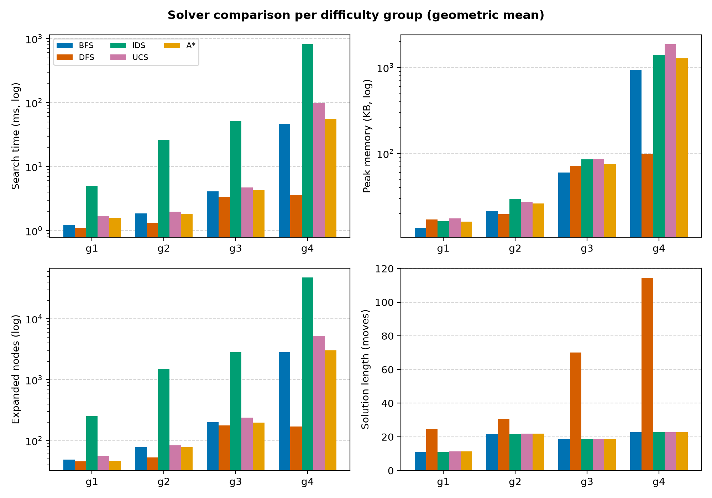

*Hình 5. Thời gian, bộ nhớ, số nút mở rộng (thang log) và độ dài lời giải theo nhóm màn (trung bình nhân).*

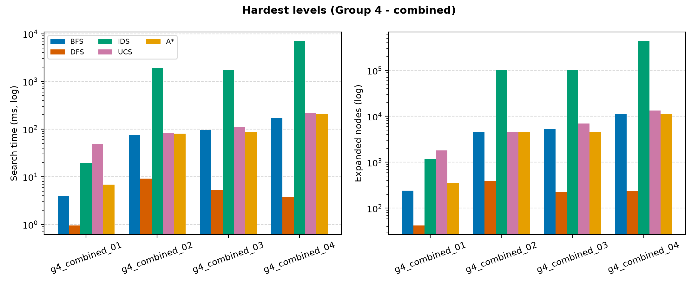

*Hình 6. Thời gian và số nút mở rộng trên 4 màn khó nhất (nhóm g4), thang log.*

### 9.4 Nhận xét

**Chất lượng lời giải.**

- BFS và IDS cho **đúng cùng số bước ở cả 16 màn**, và đó là số bước nhỏ nhất, phù hợp với phần chứng minh ở mục 4.6 và 6.6.
- Số bước nhỏ nhất **chưa chắc là cost nhỏ nhất**. Ở 3/16 màn, UCS và A\* tìm được lời giải có cost thấp hơn dù nhiều bước hơn: `g1_basic_03` (BFS 8 bước, cost 14; UCS 9 bước, cost 13), `g2_fragile_01` (16 bước, cost 24; so với 17 bước, cost 23) và `g3_switch_04` (23 bước, cost 41; so với 24 bước, cost 40). Mức vượt trung bình chỉ 0,6 đến 1,9% ở g1–g3 và 0% ở g4 (Hình 7). Hai thước đo "số nước đi" và `physics_cost` trùng nhau ở hầu hết các màn nhưng không phải luôn luôn, nên BFS và IDS tối ưu theo số nước đi mà không đảm bảo tối ưu theo cost.
- DFS là giải thuật duy nhất cho lời giải **kém hẳn**: dài gấp 1,0 đến 10,5 lần lời giải ngắn nhất (trung vị khoảng 3,1 lần) và chỉ đạt cost tối ưu ở 1/16 màn (`g2_fragile_02`). Ở g4 lời giải trung bình là 114,5 nước so với 22,8 nước, cost cao hơn khoảng 384%. Màn tệ nhất là `g4_combined_02`: 304 nước so với 29 nước tối ưu.

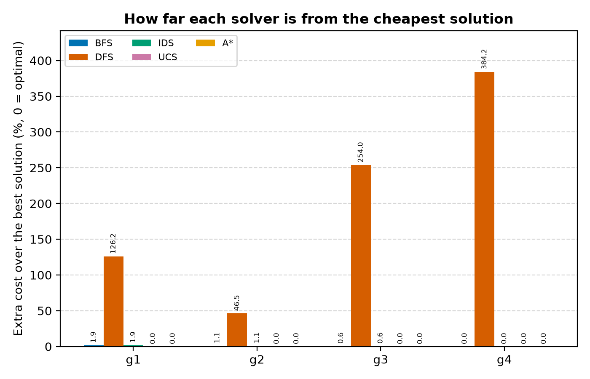

*Hình 7. Phần trăm cost vượt so với cost thấp nhất tìm được trên mỗi màn (0 nghĩa là tối ưu theo `physics_cost`).*

**Chi phí tìm kiếm.**

- **DFS** mở rộng ít nút hơn BFS ở 12/16 màn và nhanh nhất ở nhóm g4 (3,6 ms so với 46,8 ms của BFS), vì nó đi thẳng theo một nhánh mà không phải duyệt hết từng lớp. Đổi lại lời giải rất dài, và kết quả phụ thuộc vào thứ tự hành động cố định U, D, L, R: đổi thứ tự có thể cho kết quả khác hẳn. Ưu thế về tốc độ của DFS vì vậy mang tính may rủi chứ không phải được đảm bảo; Hình 2 cho thấy trên màn g1_basic_03 DFS thậm chí mở rộng nhiều nút hơn BFS.
- **BFS** có số nút mở rộng tăng nhanh theo độ khó (49 nút ở g1 lên 2.836 nút ở g4, tăng khoảng 58 lần), vì số trạng thái tăng mạnh khi có thêm ô đặc biệt, cầu (mỗi cầu làm số cấu hình cầu có thể tăng tới gấp đôi) và khối tách.
- **IDS** tốn kém nhất: mở rộng nhiều hơn BFS từ **2,9 đến 38,9 lần** và chậm hơn từ 2,6 đến 40,6 lần. Ở `g4_combined_04` IDS mở rộng 432.630 nút (so với 11.118 nút của BFS) và mất khoảng 7 giây. Nguyên nhân là mỗi lượt lặp mở rộng lại toàn bộ các trạng thái ở độ sâu nhỏ hơn (Hình 4); chênh lệch càng lớn khi lời giải càng sâu.

**Bộ nhớ.**

- Nhận định thường gặp "DFS và IDS tốn ít bộ nhớ hơn BFS" chỉ đúng với tìm kiếm dạng cây. Ở đây cả ba là tìm kiếm trên đồ thị nên đều phải giữ bảng các trạng thái đã thăm, và kết quả đo cho thấy:
  - **IDS dùng nhiều bộ nhớ hơn BFS ở cả 16 màn** (gấp 1,2 đến 1,6 lần) do bảng `reached` và `parent` cộng thêm ngăn xếp.
  - **DFS dùng ít bộ nhớ hơn BFS ở 7/16 màn**, trong đó có cả 4 màn g4 (98,8 KB so với 942,3 KB). Nhưng ở nhiều màn nhỏ DFS dùng *nhiều hơn* BFS (như `g1_basic_03`: 39,0 KB so với 20,3 KB), vì DFS đưa tất cả nút con vào ngăn xếp và `visited` trước khi quyết định đi tiếp. Ở g4 DFS tiết kiệm bộ nhớ chủ yếu vì nó tìm thấy đích chỉ sau khoảng 170 lần mở rộng, chứ không phải nhờ cấu trúc bộ nhớ tốt hơn.
- Bộ nhớ của BFS tăng khoảng 70 lần từ g1 đến g4 (13,5 KB lên 942,3 KB), cùng xu hướng với số nút; DFS chỉ tăng khoảng 6 lần (17,0 KB lên 98,8 KB) vì số nút nó khám phá gần như không đổi.

**Theo nhóm độ khó.** Ở g1 và g2 (màn nhỏ), cả năm giải thuật đều chạy dưới 50 ms nên chênh lệch tuyệt đối không đáng kể dù IDS đã chậm hơn BFS hàng chục lần về tỉ lệ. Sự khác biệt về giá trị tuyệt đối chỉ lộ rõ ở g3 và nhất là g4, nơi công tắc, cầu và khối tách làm không gian trạng thái phình lên. Vì vậy các kết luận về hiệu năng nên chủ yếu dựa vào hai nhóm này.

### 9.5 Ưu điểm và nhược điểm

| | Ưu điểm | Nhược điểm | Phù hợp khi |
|---|---|---|---|
| **BFS** | Đảm bảo ít nước đi nhất; đơn giản; ổn định, ít phụ thuộc thứ tự hành động | Số nút và bộ nhớ tăng nhanh theo độ khó; không đảm bảo cost tối ưu khi chi phí không đồng nhất | Cần lời giải ngắn nhất và không gian trạng thái vừa phải |
| **DFS** | Nhanh và ít nút nhất ở màn khó; mã nguồn ngắn | Lời giải rất dài (tới 10 lần); kết quả phụ thuộc thứ tự hành động; không tối ưu | Chỉ cần một lời giải bất kỳ, càng nhanh càng tốt |
| **IDS** | Tối ưu số nước như BFS; kết luận được "không giải được" | Chậm nhất, mở rộng nhiều nút nhất vì lặp lại; trong cài đặt trên đồ thị không tiết kiệm bộ nhớ so với BFS | Khi cần tính tối ưu và hạn chế bộ nhớ chặt (dạng cây thuần túy) |

### 9.6 Hạn chế của thực nghiệm

- Mỗi nhóm chỉ có 4 màn nên trung bình nhân chỉ có ý nghĩa định tính.
- Thời gian là trung vị của 3 lần chạy trên một máy, có thể dao động theo tải hệ thống; các màn g1–g2 chạy chỉ vài mili giây nên sai số tương đối lớn. Bộ nhớ đo bằng `tracemalloc` chỉ tính phần cấp phát bởi Python, không phải toàn bộ RAM của tiến trình.
- Kết quả của DFS gắn với thứ tự hành động cố định và không thể khái quát cho thứ tự khác.

---

## 10. Kết luận

Trong ba giải thuật không có thông tin, **BFS là lựa chọn cân bằng nhất** cho bài toán này: tối ưu theo số nước đi, mở rộng ít nút hơn IDS rất nhiều, và không kém về chất lượng lời giải như DFS. DFS nhanh nhưng cho lời giải dài, phụ thuộc thứ tự duyệt. IDS cho cùng lời giải với BFS (xác nhận qua việc hai giải thuật có cùng số bước ở cả 16 màn) nhưng chi phí cao hơn và, vì được cài đặt trên đồ thị, không còn lợi thế về bộ nhớ vốn là lý do chính để dùng IDS. Khi cần cost nhỏ nhất theo `physics_cost` thì cần dùng UCS hoặc A\*, vốn tối ưu theo chính hàm chi phí đó.

---

## Phụ lục. Tái tạo số liệu và hình

Các lệnh dưới đây chạy từ thư mục `Source/` với môi trường ảo của dự án.

```
python -m benchmark.benchmark --output benchmark/results/<tên>.csv     # chạy toàn bộ 16 màn × 5 giải thuật
python -m benchmark.report benchmark/results/<tên>.csv                 # bảng (report_tables.md) và các Hình 5, 6, 7
python -m benchmark.illustrations                                      # các Hình 1, 2, 3, 4
```

Tệp CSV, bảng và 7 hình dùng trong bài được lưu ở [docs/experiments/](experiments/README.md), kèm cấu hình máy và commit để chạy lại.

Bảng A1 liệt kê đủ 80 lượt chạy (16 màn × 5 giải thuật), lấy từ cùng tệp CSV với các bảng ở mục 9.3. Dấu `*` đánh dấu cost thấp nhất tìm được trên màn đó.

**Bảng A1. Kết quả chi tiết theo từng màn**

*Nhóm g1 (cơ bản)*

| Màn | Giải thuật | Số bước | Cost | Số nút mở rộng | Thời gian (ms) | Bộ nhớ đỉnh (KB) |
|---|---|---:|---:|---:|---:|---:|
| g1_basic_01 | BFS | 8 | 12 \* | 41 | 1,01 | 11,5 |
| g1_basic_01 | DFS | 24 | 38 | 29 | 0,75 | 12,0 |
| g1_basic_01 | IDS | 8 | 12 \* | 142 | 3,79 | 14,1 |
| g1_basic_01 | UCS | 8 | 12 \* | 44 | 1,82 | 14,0 |
| g1_basic_01 | A\* | 8 | 12 \* | 37 | 1,12 | 14,3 |
| g1_basic_02 | BFS | 12 | 20 \* | 57 | 1,66 | 15,2 |
| g1_basic_02 | DFS | 18 | 30 | 59 | 1,34 | 17,4 |
| g1_basic_02 | IDS | 12 | 20 \* | 316 | 5,41 | 17,6 |
| g1_basic_02 | UCS | 12 | 20 \* | 61 | 1,30 | 18,6 |
| g1_basic_02 | A\* | 12 | 20 \* | 56 | 3,39 | 19,1 |
| g1_basic_03 | BFS | 8 | 14 | 65 | 1,71 | 20,3 |
| g1_basic_03 | DFS | 41 | 67 | 84 | 1,99 | 39,0 |
| g1_basic_03 | IDS | 8 | 14 | 191 | 4,39 | 23,7 |
| g1_basic_03 | UCS | 9 | 13 \* | 89 | 2,98 | 35,5 |
| g1_basic_03 | A\* | 9 | 13 \* | 60 | 1,50 | 24,6 |
| g1_basic_04 | BFS | 19 | 29 \* | 38 | 0,81 | 9,4 |
| g1_basic_04 | DFS | 21 | 31 | 30 | 0,73 | 10,3 |
| g1_basic_04 | IDS | 19 | 29 \* | 473 | 7,08 | 11,7 |
| g1_basic_04 | UCS | 19 | 29 \* | 40 | 1,16 | 10,2 |
| g1_basic_04 | A\* | 19 | 29 \* | 37 | 1,10 | 9,8 |

*Nhóm g2 (ô dễ vỡ)*

| Màn | Giải thuật | Số bước | Cost | Số nút mở rộng | Thời gian (ms) | Bộ nhớ đỉnh (KB) |
|---|---|---:|---:|---:|---:|---:|
| g2_fragile_01 | BFS | 16 | 24 | 98 | 2,38 | 26,6 |
| g2_fragile_01 | DFS | 39 | 59 | 59 | 1,21 | 20,4 |
| g2_fragile_01 | IDS | 16 | 24 | 1.469 | 23,87 | 39,3 |
| g2_fragile_01 | UCS | 17 | 23 \* | 99 | 1,96 | 32,7 |
| g2_fragile_01 | A\* | 17 | 23 \* | 93 | 2,14 | 32,0 |
| g2_fragile_02 | BFS | 19 | 31 \* | 41 | 0,93 | 11,4 |
| g2_fragile_02 | DFS | 19 | 31 \* | 38 | 0,84 | 13,1 |
| g2_fragile_02 | IDS | 19 | 31 \* | 460 | 8,86 | 13,3 |
| g2_fragile_02 | UCS | 19 | 31 \* | 49 | 1,18 | 16,2 |
| g2_fragile_02 | A\* | 19 | 31 \* | 43 | 1,16 | 14,2 |
| g2_fragile_03 | BFS | 24 | 38 \* | 87 | 1,64 | 25,0 |
| g2_fragile_03 | DFS | 35 | 57 | 36 | 1,06 | 15,8 |
| g2_fragile_03 | IDS | 24 | 38 \* | 2.920 | 45,90 | 35,8 |
| g2_fragile_03 | UCS | 24 | 38 \* | 94 | 2,47 | 32,2 |
| g2_fragile_03 | A\* | 24 | 38 \* | 87 | 1,99 | 31,1 |
| g2_fragile_04 | BFS | 30 | 46 \* | 104 | 3,25 | 27,4 |
| g2_fragile_04 | DFS | 35 | 55 | 95 | 2,73 | 35,3 |
| g2_fragile_04 | IDS | 30 | 46 \* | 2.570 | 48,18 | 41,1 |
| g2_fragile_04 | UCS | 30 | 46 \* | 106 | 2,66 | 33,4 |
| g2_fragile_04 | A\* | 30 | 46 \* | 104 | 2,31 | 33,1 |

*Nhóm g3 (công tắc và cầu)*

| Màn | Giải thuật | Số bước | Cost | Số nút mở rộng | Thời gian (ms) | Bộ nhớ đỉnh (KB) |
|---|---|---:|---:|---:|---:|---:|
| g3_switch_01 | BFS | 15 | 29 \* | 168 | 3,58 | 50,3 |
| g3_switch_01 | DFS | 55 | 95 | 186 | 3,96 | 66,1 |
| g3_switch_01 | IDS | 15 | 29 \* | 1.709 | 27,75 | 74,5 |
| g3_switch_01 | UCS | 15 | 29 \* | 203 | 3,81 | 69,5 |
| g3_switch_01 | A\* | 15 | 29 \* | 187 | 4,35 | 67,2 |
| g3_switch_02 | BFS | 14 | 24 \* | 104 | 1,98 | 31,8 |
| g3_switch_02 | DFS | 53 | 89 | 123 | 2,35 | 46,6 |
| g3_switch_02 | IDS | 14 | 24 \* | 900 | 14,96 | 40,3 |
| g3_switch_02 | UCS | 14 | 24 \* | 130 | 2,51 | 45,2 |
| g3_switch_02 | A\* | 14 | 24 \* | 95 | 2,35 | 36,8 |
| g3_switch_03 | BFS | 24 | 42 \* | 299 | 7,09 | 101,0 |
| g3_switch_03 | DFS | 76 | 130 | 186 | 3,08 | 69,7 |
| g3_switch_03 | IDS | 24 | 42 \* | 7.524 | 173,14 | 152,3 |
| g3_switch_03 | UCS | 24 | 42 \* | 374 | 6,74 | 136,7 |
| g3_switch_03 | A\* | 24 | 42 \* | 309 | 6,09 | 130,4 |
| g3_switch_04 | BFS | 23 | 41 | 301 | 5,58 | 80,5 |
| g3_switch_04 | DFS | 109 | 167 | 237 | 4,56 | 121,4 |
| g3_switch_04 | IDS | 23 | 41 | 5.566 | 95,50 | 116,9 |
| g3_switch_04 | UCS | 24 | 40 \* | 333 | 7,56 | 128,0 |
| g3_switch_04 | A\* | 24 | 40 \* | 281 | 5,71 | 98,8 |

*Nhóm g4 (kết hợp)*

| Màn | Giải thuật | Số bước | Cost | Số nút mở rộng | Thời gian (ms) | Bộ nhớ đỉnh (KB) |
|---|---|---:|---:|---:|---:|---:|
| g4_combined_01 | BFS | 12 | 22 \* | 242 | 3,88 | 108,0 |
| g4_combined_01 | DFS | 24 | 42 | 42 | 0,96 | 16,6 |
| g4_combined_01 | IDS | 12 | 22 \* | 1.175 | 19,48 | 135,4 |
| g4_combined_01 | UCS | 12 | 22 \* | 1.816 | 48,33 | 690,3 |
| g4_combined_01 | A\* | 12 | 22 \* | 357 | 6,87 | 197,7 |
| g4_combined_02 | BFS | 29 | 39 \* | 4.597 | 74,68 | 1.233,2 |
| g4_combined_02 | DFS | 304 | 376 | 390 | 9,11 | 273,8 |
| g4_combined_02 | IDS | 29 | 39 \* | 104.403 | 1.906,44 | 1.949,9 |
| g4_combined_02 | UCS | 29 | 39 \* | 4.641 | 81,70 | 1.527,6 |
| g4_combined_02 | A\* | 29 | 39 \* | 4.552 | 79,85 | 1.659,2 |
| g4_combined_03 | BFS | 25 | 33 \* | 5.228 | 96,73 | 1.719,6 |
| g4_combined_03 | DFS | 141 | 181 | 224 | 5,21 | 147,4 |
| g4_combined_03 | IDS | 25 | 33 \* | 100.085 | 1.745,56 | 2.652,8 |
| g4_combined_03 | UCS | 25 | 33 \* | 6.932 | 113,06 | 2.440,9 |
| g4_combined_03 | A\* | 25 | 33 \* | 4.649 | 86,73 | 1.729,5 |
| g4_combined_04 | BFS | 31 | 45 \* | 11.118 | 171,15 | 3.444,0 |
| g4_combined_04 | DFS | 167 | 245 | 234 | 3,75 | 142,6 |
| g4_combined_04 | IDS | 31 | 45 \* | 432.630 | 6.954,95 | 5.465,3 |
| g4_combined_04 | UCS | 31 | 45 \* | 13.405 | 221,66 | 4.718,5 |
| g4_combined_04 | A\* | 31 | 45 \* | 11.315 | 204,50 | 4.630,9 |
